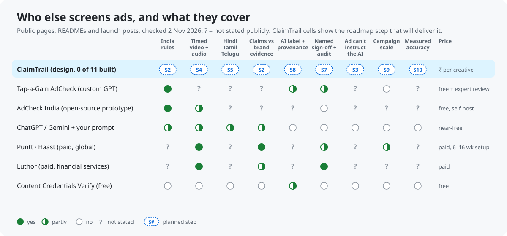

# Competitors, and what changes because of them

**Short version:** checking one ad against ASCI is already free. Tap-a-Gain's AdCheck, a custom ChatGPT built by a former ASCI Secretary-General, does exactly that. What nobody in India offers is the rest of ClaimTrail's plan:

- reels and voiceovers checked to the frame, in Hindi, Tamil and Telugu
- every claim checked against the brand's own lab reports
- a named sign-off the platform enforces
- campaign scale, with measured accuracy

So ClaimTrail should not pitch itself as an ad checker. It should be the campaign pre-screen for regional video, with an audit trail.

## Who's out there

| | What it is | Strengths | Weaknesses (for an Indian brand or agency reviewer) |
|---|---|---|---|
| **Tap-a-Gain AdCheck** ([page](https://tap-a-gain.com/advertisement-review-service/)) | A free custom GPT on ChatGPT, built by former ASCI Secretary-General Shweta Purandare; optional paid human review by her | Real ASCI credibility; free; covers claims, disclaimers, influencer disclosure and AI-generated content; risk score and PDF; one-click route to an expert | One ad at a time in a chat; needs a ChatGPT account; no published accuracy; video, audio and regional speech not stated; no record of who approved what; it's a prompt, so an ad can try to instruct it |
| **AdCheck India** ([GitHub](https://github.com/Mayankdigital/AdCheckIndia)) | Open-source prototype: Llama vision on images and sampled video frames, plus retrieval over ASCI, CCPA, FSSAI and SEBI rules | Cites the rule broken; suggests a rewrite; video timeline; free to self-host | Prototype (0 stars, last commit 5 Oct 2026); samples keyframes rather than timing disclaimers; no speech, brand evidence or sign-off stated |
| **ChatGPT / Gemini + your prompt** | What a marketer can do today for close to nothing | Gemini reads video and audio, including Hindi; general ASCI knowledge; can read an uploaded lab report | No cited clause; no frame-accurate timing; different answer each run; no audit trail; no batch; an ad's hidden text can steer it |
| **Puntt, Haast** (paid, global) | Enterprise marketing-compliance platforms | Video analysis; claims checked against substantiation (Puntt); approval workflows tuned to the company's risk tolerance (Haast) | US and global focus, India rules not stated; 6–16 week setup (vendor-reported); enterprise pricing |
| **Luthor** (paid, [YC](https://www.ycombinator.com/launches/QSd-luthor-ai-compliance-infrastructure-for-regulated-marketing)) | Compliance infrastructure for regulated marketing, aimed at financial services | Text, image, video and audio; citation-backed flags; audit-ready (SOC 2 Type II, SEC 17a-4) | Built for US financial services; India rules not stated |
| **Content Credentials Verify** (free) | Reads C2PA provenance metadata from a file | Free; shows how an image or video was made, when the metadata is there | Provenance only; most ads carry no metadata, so the check is often silent |

**Background that raises the stakes:**
- MeitY's IT Rules amendment requires labels on synthetic audio and video ([in force 20 Feb 2026](https://www.legal500.com/intelligence/india/media-telecoms-it-entertainment/2026-it-rules-amendments-ai-content-labelling-and-intermediary-obligations)).
- ASCI's AI-labelling guidelines for advertisers apply from 29 Dec 2026 ([draft](https://www.ascionline.in/wp-content/uploads/2026/05/asci-ai-labelling-guidelines.pdf)).
- 93% of ASCI's FY26 cases came from its own proactive monitoring.

## Weighed against what a reviewer actually needs

How much each need matters is our judgement for a brand or agency team clearing an Indian campaign.

| Need | Weight | Best today | ClaimTrail plan |
|---|---|---|---|
| Flags the likely rule problems in one ad | ★★★ | **Tap-a-Gain AdCheck** (free, expert-built) | step 2: match it, don't sell it |
| Spoken claims and on-screen disclaimers in reels, timed | ★★★ | nobody verified for India | **step 4**: the main wedge |
| Hindi, Tamil and Telugu versions of the same campaign | ★★★ | Gemini + prompt, partly | **step 5**: the main wedge |
| Proof: rule clause and the brand's own lab-report page | ★★★ | Puntt, Luthor (abroad) | **step 2** |
| Who approved it, when, on what evidence | ★★ | Luthor, Haast (abroad) | **step 7**: platform-enforced |
| Hundreds of variants overnight, at a known cost | ★★ | enterprise platforms | **step 9** |
| A number for accuracy, not a claim | ★★ | nobody publishes one | **step 10** |
| AI label decided correctly under the new rules | ★★ | partial everywhere | **step 8** |
| An ad can't talk the checker into clearing it | ★ | nobody states it | **step 3** |

## What changes in the plan

| Change | Why |
|---|---|
| ✅ **Step 10 gains a second baseline, B1:** one gpt-5.4 call with all 40 rules and the same view of the ad, no tools, on the same held-out set; the README number reports it beside B0 | B0 (step 1's checker) knows only 5 rules, so beating it proves little. B1 is what an AdCheck-style GPT does, so it answers "why not ChatGPT?" with a measurement. ClaimTrail has to beat it on timed disclaimers, regional speech and evidence citations, or say plainly where it doesn't. Added to the step 10 walkthrough with tests (71 pass) |
| ✅ **Lead the README demo with a Hindi or Telugu reel** (steps 4 and 5), not a script check | Checking a script is what the free GPT already does; timed regional video is the gap |
| ✓ **Already in step 2's rule library:** MeitY's synthetic-content rules (`ITR-SGI-PLATFORM`, Feb 2026) and ASCI's AI-labelling guidelines (`SGC-LABEL-REQUIRED`, `SGC-LABEL-FORM`, `SGC-NO-LABEL`, `SGC-PROHIBITED`, from 29 Dec 2026) | Specific, checkable rules with clause and date, where competitors mention AI labels only in general terms. Nothing to add |
| ✅ **Step 8 reads Content Credentials** with the open C2PA tools instead of rebuilding them | Free and standard; ClaimTrail adds the decision ("label needed: yes, no, or a person decides") |
| ✗ **Not doing:** certification or legal clearance | Tap-a-Gain sells expert human review; ClaimTrail stays a pre-screen that routes to *your* named reviewer |
| ✗ **Not doing:** US or financial-services rule packs | Luthor and others own that; ClaimTrail's edge is India |

## How this was checked

- Web search across vendor pages, launch posts and law-firm notes; facts above link to their source.
- Tap-a-Gain's page was read in a sandboxed browser, which showed that its "Check my advertisement" button opens a custom GPT on chatgpt.com.
- REA ([morluto/rea](https://github.com/morluto/rea)) was tried on the same page. It listed the page's links and structure but added nothing a plain page read didn't.
- Only public pages were read. Nothing behind a login was accessed.

Checked 2 Nov 2026. "Not stated" means we found no public statement, not that a feature is missing. Vendor capabilities are as described on their own pages and are unverified.
