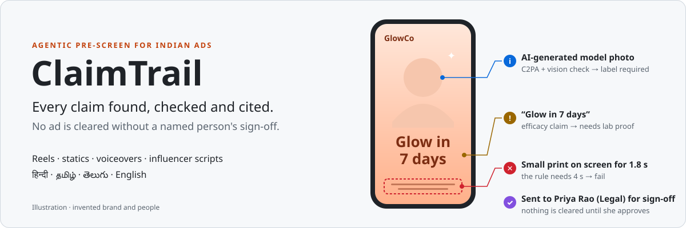
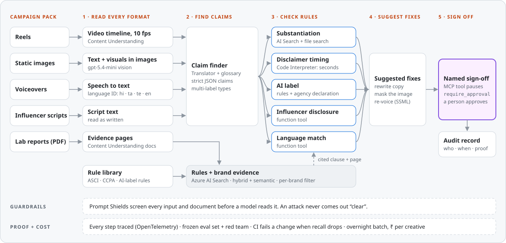
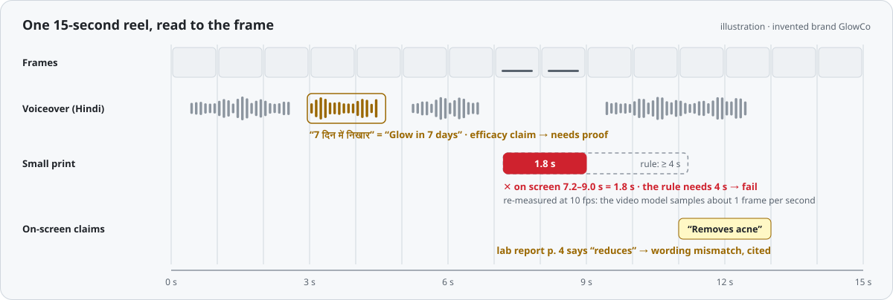
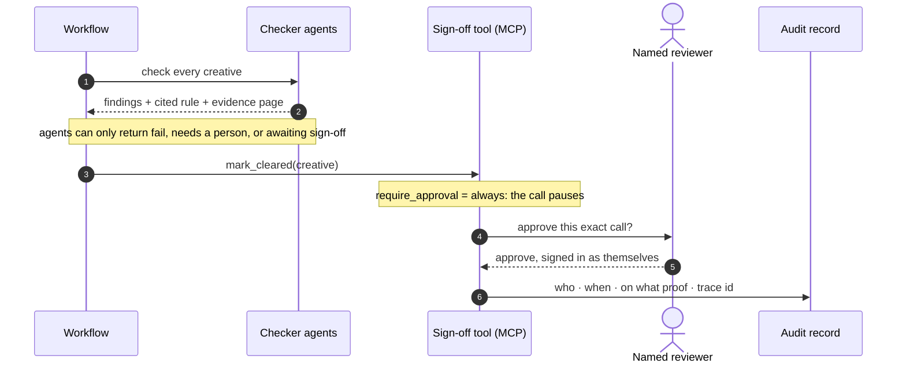
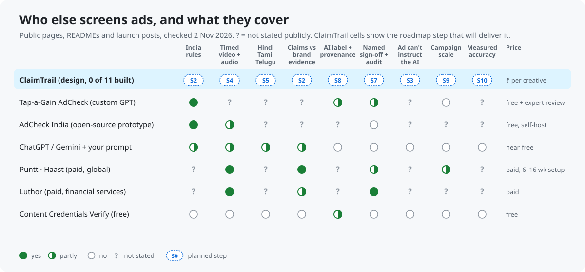
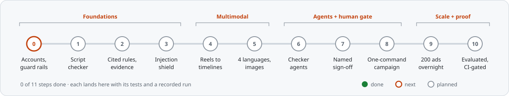

<p align="center">
  
</p>

<p align="center">
  
  
  
  
</p>

> [!NOTE]
> **Built in public, one step at a time.** The design, rule library and test plan are done. Each step lands here once it has been built and run. Nothing is deployed yet: the roadmap below is the source of truth.

## Why

- **The rules put the burden on brands.** India's ASCI code, consumer-protection law and new AI-label guidance all apply.
- **Nobody checks the regional versions.** One campaign carries hundreds of variants, and the Hindi, Tamil and Telugu ones are the ones that get skipped.
- **A chatbot can only guess.** It can't time a disclaimer to the frame, cite the lab-report page, or prove that a human approved.

## How it works



## What a finding looks like



| Catches | How |
|---|---|
| A claim spoken in Hindi, Tamil or Telugu | Speech-to-text with language ID, then claim patterns and timestamps |
| Small print shown too briefly | A frame-accurate (10 fps) re-measure against the rule's minimum |
| A claim stronger than the evidence | Search over the brand's lab reports, with the quote checked word for word |
| An unlabelled AI-generated image | Content Credentials (C2PA), a vision check and the rule text |
| An ad that hides orders for the AI | Prompt Shields: an attack never comes out "clear" |

## The human gate is enforced by the platform, not the prompt



## Design principles

| | Principle | In practice |
|---|---|---|
| 🧭 | A pre-screen, never legal advice | Says "likely problem" or "needs a person", never "compliant" |
| 🔒 | Fail closed | Anything uncertain, unreadable or attacked goes to a person |
| 📎 | Evidence or it didn't happen | Every flag cites the rule clause and the evidence page |
| ✋ | The platform holds the gate | Clearing needs a named approval of the exact call; who can bypass it is written down and detected |
| 📏 | Measured, not claimed | Frozen held-out set, code-based evaluators, red teaming, and a CI gate that fails a change when recall drops |
| ₹ | Cost per ad is a feature | Overnight batch, one retry layer, prompt caching, and ₹ per creative on a dashboard |

## Who else does this



- **Checking one ad is already free.** Tap-a-Gain's AdCheck is a custom GPT built by a former ASCI Secretary-General.
- **The gap ClaimTrail targets:** reels in Hindi, Tamil and Telugu, timed to the frame, checked against the brand's own evidence, with a named sign-off and a measured accuracy.
- Details and what changed in the plan: [COMPETITORS.md](COMPETITORS.md).

## Roadmap



<details>
<summary>What each step proves</summary>

| # | Step | Proves |
|---|---|---|
| 0 | Accounts, budget alarms, block expensive deployments | The cloud bill can't surprise anyone |
| 1 | Script checker | Strict structured output and tool calls |
| 2 | Cited rules and evidence | Hybrid search with a per-brand filter; rules include MeitY's synthetic-content amendment and ASCI's AI-labelling guidelines |
| 3 | Injection shield | Ads and PDFs can't instruct the model |
| 4 | Reels and lab reports become timelines | Video and documents read to the frame and the page |
| 5 | Every language, every image | Hindi, Tamil, Telugu and English; claim types |
| 6 | Rule-checker agents | Agents with only the tools they need, traced end to end |
| 7 | Named human sign-off | An approval the platform enforces |
| 8 | One "check campaign" workflow | AI-label decision and suggested fixes in one command |
| 9 | Campaign scale | 200 ads overnight and ₹ per creative |
| 10 | Evaluated, red-teamed, CI-gated, hosted | The numbers in this README come from files, not claims, including a ChatGPT or Gemini with-a-prompt baseline on the same held-out set |

</details>

## Stack

Python 3.12 · [uv](https://docs.astral.sh/uv/) · Microsoft Foundry (Agent Service, Content Understanding, AI Search, Speech, Translator, Content Safety) · Agent Framework · OpenTelemetry · keyless (Entra ID) everywhere

## Run

```bash
uv sync
```

Each step adds its own commands here when it lands.

---

<sub>ClaimTrail screens ads for likely rule problems and records who signed them off. It isn't legal advice, and it doesn't certify that an ad complies with any law or code. All brands, people and ads in the examples are invented.</sub>
